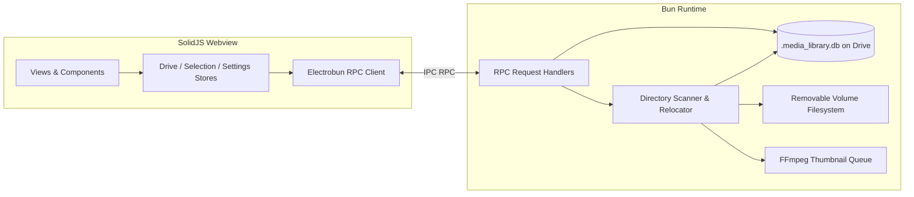

# Original Codebase Analysis (`heisdezz/drive`)

This document details the architecture, code organization, and operational semantics of the source project at `https://github.com/heisdezz/drive`.

---

## 1. High-Level Architecture

The reference application is an **Electrobun** desktop application consisting of two primary processes:
1. **Renderer Process**:
   - Built with SolidJS, TanStack Router, TanStack Query, Tailwind CSS, DaisyUI, and Kobalte.
   - Hosted in a WebKit webview window.
   - Communicates with the backend exclusively via Electrobun's typed RPC layer (`ElectrobunRPCSchema`).
2. **Main/Backend Process**:
   - Runs in the **Bun** JavaScript runtime.
   - Handles low-level disk I/O, SQLite operations (`bun:sqlite`), child processes (`ffmpeg`), and local HTTP streaming servers (Media Server and Mobile Sync).



---

## 2. Directory Structure of Reference Codebase

```text
.reference-drive/
├── src/
│   ├── bun/                    # Backend Main Process
│   │   ├── index.ts            # Entrypoint, RPC server registration
│   │   ├── database.ts         # SQLite schema initialization, triggers, migrations
│   │   ├── drives.ts           # Drive detection via systeminformation
│   │   ├── scanner.ts          # Media scanner, directory walker, and file mover
│   │   ├── file-ops.ts         # Move journal, rollbacks, atomic file operations
│   │   ├── album-rescan.ts     # Library verification and reconciliation
│   │   ├── album-location.ts   # Resolving album folder root on drives
│   │   ├── thumbnails.ts       # FFmpeg thumbnail generation with pause/resume gates
│   │   ├── media-server.ts     # Local media streaming server (127.0.0.1)
│   │   ├── mobile-sync.ts      # LAN mobile sync HTTP server
│   │   └── handlers/           # RPC request handlers grouped by domain
│   │       ├── drives.ts
│   │       ├── scan.ts
│   │       ├── media.ts
│   │       ├── albums.ts
│   │       ├── backup.ts
│   │       └── mobile-sync.ts
│   ├── mainview/               # Frontend Renderer Process
│   │   ├── App.tsx             # Root app component
│   │   ├── routes/             # TanStack Solid Router routes
│   │   │   ├── __root.tsx      # Sidebar + Header layout wrapper
│   │   │   ├── index.tsx       # Dashboard
│   │   │   ├── discover.index.tsx  # Drive scanner & ignorelist management
│   │   │   ├── medias.index.tsx    # Flat media catalog & bulk selection
│   │   │   ├── albums.index.tsx    # Album card gallery & context menu
│   │   │   ├── album.$id.index.tsx # Single album media view
│   │   │   ├── item.$id.index.tsx  # Media item detail & player
│   │   │   ├── settings.index.tsx  # App settings & LAN server
│   │   │   └── about.tsx       # System info
│   │   ├── components/         # Reusable UI components
│   │   └── store/              # Reactive stores (drive_store, selection_store, settings_store)
│   └── shared/
│       └── rpc.ts              # Electrobun typed RPC schema
```

---

## 3. Core RPC Endpoints (`src/shared/rpc.ts`)

| Domain | Method | Purpose |
| :--- | :--- | :--- |
| **Drives** | `getDrives` | Enumerates internal, external, and custom mounted drives |
| | `mountBlockDevice` | Mounts an unmounted block device |
| | `setActiveMediaDrive`| Sets active drive path for the local media server |
| **Albums** | `getAlbums` | Lists all albums with `media_count` and newest item preview |
| | `getAlbum` | Fetches details for a single album |
| | `createAlbum` | Creates a new album directory & database entry |
| | `editAlbum` | Renames album directory, updates child albums & media paths |
| | `deleteAlbum` | Deletes album (Keep files -> Unsorted, or Permanent delete) |
| | `mergeAlbums` | Moves media from source album to target album with rename journal |
| | `validateAlbumFiles`| Checks disk existence and removes dead catalog records |
| **Media** | `getMediaItems` | Paginated, filtered (images/videos), sorted media catalog |
| | `getMediaItem` | Returns single media item with next/prev IDs for navigation |
| | `moveMediaItemsToAlbum` | Relocates selected files to target album directory |
| | `deleteMediaItems` | Safely removes files and catalog entries |
| | `getThumbnail` | Generates or retrieves cached JPEG thumbnail |
| **Scanner** | `startScan` | Walks source folder, applies ignore list, moves media to albums |
| | `stopScan` | Halts directory scanning |
| | `getScanStatus` | Real-time counts (`scannedCount`, `foundCount`, active folder) |
| | `startAlbumRescan` | Full library audit and reconciliation |

---

## 4. Key Behavior Patterns to Preserve in Rust

1. **Folder Relocation Rules**:
   - Files found in the root of the scanned directory move into `albums/unknown/`.
   - Files found inside a subdirectory (e.g. `raw_dumps/2026-Holiday/photo.jpg`) move into an album matching that directory name (e.g. `albums/2026-Holiday/photo.jpg`).
   - If an album name already exists for a different source directory, a numeric suffix is appended (`Holiday_2`, `Holiday_3`).
2. **Name Collision Handling**:
   - If `destDir/photo.jpg` already exists:
     - Check file hash / stats: if identical, deduplicate.
     - If different, increment suffix: `photo_1.jpg`, `photo_2.jpg`.
3. **Empty Source Directory Cleanup**:
   - Once scanning is complete, empty directories in the scanned path are removed (excluding the drive root or root scan directory).
4. **Pause During Playback**:
   - When a video begins playback, background thumbnail generation must be paused (`SIGSTOP` on video decoders or yielding CPU) to prevent video frame drops.
