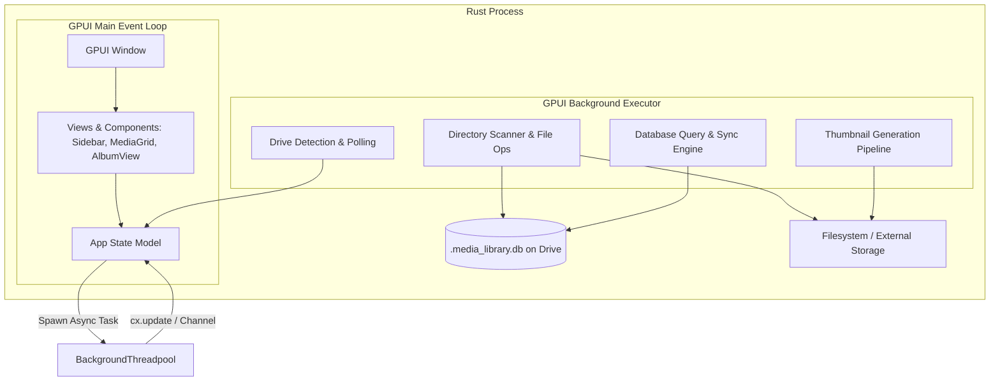

# System Architecture & Rust Port Design

This document describes the architectural transition from Electrobun's multi-process model to a unified, native Rust application powered by **GPUI** and **`gpui-kit`**.

---

## 1. Unified Single-Process Architecture

In the original Electrobun architecture, every UI action had to cross a JSON RPC IPC boundary between WebKit and Bun. In Rust, we collapse this into a high-performance **single-process architecture**:



### Advantages of the Rust Architecture:
- **Zero IPC Latency**: Queries return native Rust structs with zero serialization overhead between UI and business logic.
- **Minimal Resource Footprint**: Eliminates WebKit browser engine memory overhead (~200MB+ down to ~30-50MB).
- **Direct OS & Hardware Access**: Direct disk I/O, `sysinfo` queries, and SIMD-accelerated image decoding.
- **Compile-Time Safety**: Strong type system ensures safe concurrent operations across background scanning and UI threads.

---

## 2. Threading & Concurrency Model

GPUI utilizes an explicit async architecture:
1. **Foreground / UI Thread (`gpui::Context`)**:
   - Manages windows, user input, layouts, and rendering.
   - Synchronous UI updates via `cx.update(|model, cx| { ... })`.
   - Never blocks on disk I/O, database queries, or media decoding.
2. **Background Executor (`cx.background_executor()`)**:
   - Runs computationally heavy tasks (scanning, hashing, file moving, thumbnail generation, database queries).
   - Tasks report back to the UI thread using `cx.update_model(...)` or unbounded channels (`crossbeam_channel` or `tokio::sync::mpsc`).

---

## 3. Rust Codebase Directory Layout

The application will be organized into clean, decoupled modules:

```text
rust-drive/
├── Cargo.toml
├── src/
│   ├── main.rs                 # GPUI Application entrypoint & window bootstrap
│   ├── app.rs                  # Root App View, route switcher, layout frame
│   ├── state/                  # Reactive App State
│   │   ├── mod.rs
│   │   ├── app_state.rs        # Central AppState Model
│   │   ├── drive_store.rs      # Selected drive, drive list, mount state
│   │   └── selection_store.rs  # Selected media items, active filters
│   ├── db/                     # Direct SQLite Database Layer
│   │   ├── mod.rs
│   │   ├── schema.rs           # Table creations, triggers, and indices
│   │   ├── connection.rs       # Connection pool / handle management
│   │   ├── media.rs            # Media CRUD & pagination queries
│   │   └── albums.rs           # Album CRUD, counts, and merge queries
│   ├── drives/                 # Drive Detection & Management
│   │   ├── mod.rs
│   │   └── detector.rs         # sysinfo volume scanning & mount handling
│   ├── scanner/                # Media Discovery & File Operations
│   │   ├── mod.rs
│   │   ├── walker.rs           # Recursive filesystem traversal & ignore filtering
│   │   ├── relocator.rs        # Safe file move, collision handling, rollback
│   │   └── rescan.rs           # Library validation and reconciliation
│   ├── thumbnails/             # Thumbnail Pipeline
│   │   ├── mod.rs
│   │   ├── generator.rs        # Image resizing (image crate) & video frames (ffmpeg)
│   │   └── queue.rs            # Background queue with playback pause gate
│   └── components/             # GPUI-Kit UI Components
│       ├── mod.rs
│       ├── sidebar.rs          # Navigation & Drive selector sidebar
│       ├── drive_card.rs       # Drive status & storage bar
│       ├── media_card.rs       # Thumbnail, badge, selection indicator
│       ├── media_grid.rs       # Virtualized media card grid & pagination
│       ├── album_card.rs       # Album card with cover preview & count
│       ├── album_grid.rs       # Albums gallery view
│       ├── filter_bar.rs       # Search, filter tabs, sort dropdown
│       ├── media_player.rs     # Video / photo preview modal
│       ├── dialogs/            # Modals & Dialogs
│       │   ├── mod.rs
│       │   ├── create_album.rs
│       │   ├── edit_album.rs
│       │   ├── delete_album.rs
│       │   └── merge_album.rs
│       └── views/              # Main Screen Views
│           ├── mod.rs
│           ├── dashboard.rs
│           ├── discover.rs
│           ├── medias.rs
│           ├── albums.rs
│           ├── album_detail.rs
│           └── settings.rs
```

---

## 4. Dependencies Strategy

```toml
[dependencies]
# UI Framework & Components
gpui-kit = "0.8.1"
gpui = { version = "0.1", optional = false } # Re-exported or pinned via gpui-kit

# Database (Simple & Direct)
rusqlite = { version = "0.32", features = ["bundled", "bundled-full", "vtab"] }

# System & Storage
sysinfo = "0.33"

# Images & Media
image = { version = "0.25", default-features = false, features = ["jpeg", "png", "webp"] }

# Asynchronous & Concurrency
tokio = { version = "1.40", features = ["rt-multi-thread", "sync", "fs"] }
crossbeam-channel = "0.5"

# Serialization & Utils
serde = { version = "1.0", features = ["derive"] }
serde_json = "1.0"
chrono = { version = "0.4", features = ["serde"] }
tracing = "0.1"
tracing-subscriber = "0.3"
```
