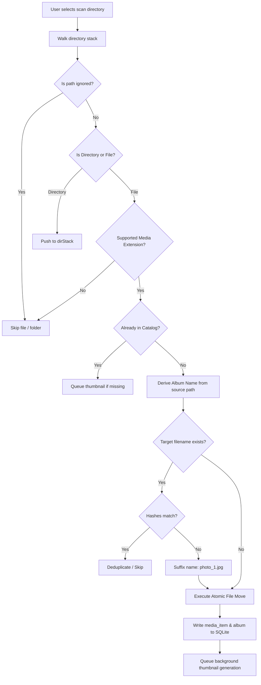

# File Operations & Media Scanner

This document outlines the filesystem scanning engine, ignore filtering rules, album auto-classification, and safety protocols for moving files on physical drives.

---

## 1. Scanner Workflow & Rules

The scanner crawls a user-selected folder (or the root of an external drive) and catalogs all detected photos and videos.

---

## 2. Path Ignore List Rules

Built-in system skip rules:
1. `albums/` (The library folder itself)
2. `.*` (Any hidden file or dotfolder: `.git`, `.Trash`, `.DS_Store`, `.backups`)
3. `node_modules/`, `build/`, `dist/`
4. `System Volume Information/`, `$RECYCLE.BIN/`, `lost+found/`

User-configured ignore rules (e.g. `temp`, `cache`, `raw_dumps`, `exports/drafts`) match complete path segments anywhere in the relative path.

---

## 3. Album Classification Logic

Files are physically organized based on their relative source folder:
- **Root-level files**: If a media file is discovered in the root folder being scanned, it is moved to `albums/unknown/`.
- **Subdirectory files**: If a media file is in `Trip2026/beach.jpg`, it is moved to `albums/Trip2026/beach.jpg`.
- **Nested directories**: Nested paths map to hierarchical album folders or sanitized album names, ensuring directories sharing common leaf names are disambiguated via `scan_album_sources`.

---

## 4. Name Collision Handling

When moving `beach.jpg` into `albums/Trip2026/`:
1. Check if `albums/Trip2026/beach.jpg` exists.
2. If it does not exist: perform rename directly.
3. If it exists:
   - Calculate hash / fingerprint (`filename_size_mtime`).
   - If identical: source file is redundant; handle as duplicate.
   - If different: check `beach_1.jpg`, `beach_2.jpg`, etc., until an unused filename is found.

---

## 5. Resilience & Rollback Protocols

1. **Same-Drive Native Renames**:
   - Moves on the same filesystem use `std::fs::rename` (which is atomic and instantaneous).
   - If `EXDEV` (cross-device move) occurs, fall back to copy-then-delete.
2. **Rollback Journal**:
   - Write a temporary journal before moving batches.
   - If a drive is unexpectedly disconnected during a move, uncommitted moves are recovered on the next library open.
3. **Safe Deletion Staging**:
   - When deleting media or albums, files are staged to `.pending-delete/` before the SQLite transaction commits, preventing orphaned files or corrupted references.
4. **Rescan & Repair (`album-rescan`)**:
   - Validates every catalog entry against disk.
   - Missing entries are pruned.
   - Uncataloged files in `albums/` are registered.
   - Unreadable databases restore valid snapshots from `.backups/`.
