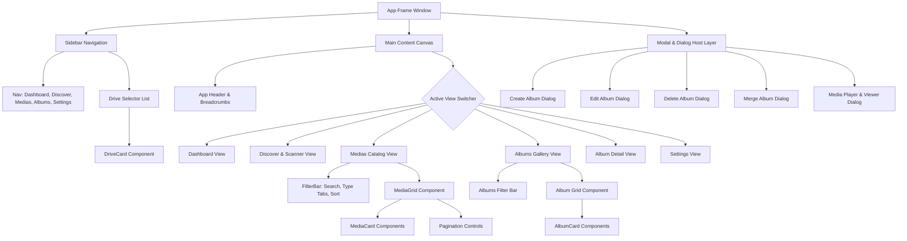

# UI Components & GPUI-Kit Design

This document details the UI design and component hierarchy for the Rust port. The user interface is implemented **component-by-component** using **GPUI** and **`gpui-kit`**.

---

## 1. Visual Design & Theme

- **Palette**: Dark theme with slate backgrounds (`#0F172A`, `#1E293B`), semi-transparent glass cards (`rgba(30, 41, 59, 0.7)`), and vibrant accent colors (Primary Blue `#3B82F6`, Success Green `#10B981`, Accent Purple `#8B5CF6`).
- **Typography**: Clean sans-serif system fonts with monospaced metadata and file paths.
- **Component Primitives**: Provided by `gpui-kit` (`Button`, `Input`, `Dialog`, `Dropdown`, `Checkbox`, `Badge`, `ScrollArea`, `Icon`).

---

## 2. Component Hierarchy

---

## 3. Component-by-Component Specifications

### 3.1 `Sidebar` & `DriveCard`
- **Location**: Fixed left pane (width ~260px).
- **Navigation Items**:
  - `Dashboard`: Overall storage statistics, quick actions, recent imports.
  - `Discover`: Ignorelist management, folder scan triggers, rescan audit.
  - `Media Library`: Flat catalog of all indexed photos and videos.
  - `Albums`: Visual album card gallery.
  - `Settings`: Preferences, grid column sliders, mobile sync LAN server.
- **Drive Selector**:
  - Lists detected drives with `DriveCard`.
  - Displays drive icon, mount name, formatted size (`1.8 TB`), and percentage bar.
  - Mount/Unmount button for unmounted block devices.

### 3.2 `MediaCard`
- **Dimensions**: Aspect-ratio preserving card (1:1 or 4:3), dynamic column grid (4 to 9 columns based on window width and user preference).
- **Contents**:
  - Thumbnail preview image with loading placeholder and error fallback.
  - Multi-select checkbox in upper-left corner (visible on hover or when items are selected).
  - Video indicator badge (with duration e.g. `02:45`) in bottom-right corner.
  - Hover action overlay: Click to open full-screen viewer (`MediaPlayer`).

### 3.3 `AlbumCard`
- **Contents**:
  - Cover preview: Uses thumbnail of newest media item in the album.
  - Album Title & hierarchical path badge.
  - Stored media count badge (e.g. `142 items`).
  - Context menu trigger (`...` button or right-click):
    - **Open Album**: Navigates to `/album/:id`.
    - **Edit Details**: Renames album or edits description.
    - **Merge Album**: Opens destination picker.
    - **Delete**: Keep files vs Delete permanently.

### 3.4 `FilterBar` & `AlbumsFilterBar`
- **Search Input**: Live debounce input filtering filenames and paths.
- **Media Type Tabs**: Segmented control for `All`, `Images`, `Videos`.
- **Sort Dropdown**: Sort by `Date Added`, `Filename`, `File Size` (Ascending / Descending).
- **Bulk Action Toolbar**: Appears when 1+ media items are selected:
  - `Move to Album...`: Opens target album selector dialog.
  - `Delete Selected`: Prompts confirmation.
  - `Deselect All`: Clears selection set.

### 3.5 Modals & Dialogs
Built with `gpui-kit` accessible modal primitives:
- **`CreateAlbumModal`**: Text input for album name + optional description.
- **`EditAlbumModal`**: Rename album with live validation against illegal filesystem characters (`/`, `\`, `:`, `*`, etc.).
- **`DeleteAlbumModal`**: Radio selection between "Keep files (Move to Unsorted)" and "Delete permanently from disk".
- **`MergeAlbumModal`**: Filterable list of destination albums.
- **`MediaPlayerModal`**:
  - Full-screen or large window overlay.
  - Shows high-res image or video player.
  - Left / Right keyboard arrow navigation between adjacent items.
  - Metadata side panel (Filename, Resolution, Size, Date, Path, EXIF).

### 3.6 `DiscoverView` (Scanner & Ignorelist Control)
- **Folder Picker**: Select source folder on drive to scan.
- **Preset Quick-Add Buttons**: `+ temp`, `+ cache`, `+ raw`, `+ backups`, `+ archive`.
- **Active Ignore Rules Badges**: Removable chips (`✕`) for active custom ignore patterns.
- **Real-Time Progress Panel**:
  - Progress bar and animation.
  - Live counters: `Checked Files`, `Imported Media`, `Active Ignore Rules`.
  - Pause / Resume / Stop buttons.
