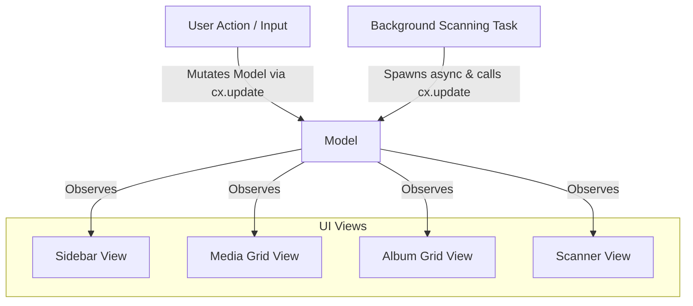

# State Management & Reactive Data Flow

This document details the state management architecture in Rust using GPUI's `Model` system, observer pattern, and async worker channels.

---

## 1. GPUI Model Architecture

In GPUI, reactive state is wrapped in a `Model<T>` (created via `cx.new_model(|cx| ...)`). Any view that reads this model can observe it with `cx.observe(&model, |view, model, cx| { cx.notify(); })` to trigger automatic re-renders when data changes.



---

## 2. Central `AppState` Structure

```rust
use std::collections::HashSet;
use std::path::PathBuf;
use std::sync::Arc;
use crate::db::LibraryDatabase;
use crate::drives::DriveInfo;
use crate::scanner::ScanProgress;

#[derive(Clone, Copy, PartialEq, Eq, Debug)]
pub enum AppRoute {
    Dashboard,
    Discover,
    Medias,
    Albums,
    AlbumDetail(i64),
    ItemViewer(i64),
    Settings,
}

pub struct AppState {
    // Navigation
    pub active_route: AppRoute,
    
    // Drives
    pub drives: Vec<DriveInfo>,
    pub selected_drive: Option<DriveInfo>,
    
    // Active SQLite Library
    pub active_db: Option<Arc<LibraryDatabase>>,
    
    // Media Catalog Query & Pagination State
    pub media_page: usize,
    pub media_page_size: usize,
    pub media_filter: MediaFilterType,
    pub media_sort: MediaSortOrder,
    pub media_search_query: String,
    
    // Selection Mode
    pub selected_media_ids: HashSet<i64>,
    
    // Scanner State
    pub is_scanning: bool,
    pub scan_progress: ScanProgress,
    pub custom_ignore_list: Vec<String>,
    
    // Active Dialog / Modal
    pub active_modal: Option<ActiveModal>,
}
```

---

## 3. Communication between Background Workers & UI

Long-running operations (such as directory scanning or thumbnail generation) must not block the GPUI UI thread. They communicate back via GPUI's async executor:

```rust
impl AppState {
    pub fn start_scanner(&mut self, source_dir: PathBuf, cx: &mut ModelContext<Self>) {
        self.is_scanning = true;
        let drive_path = self.selected_drive.as_ref().unwrap().mount_path.clone();
        let db = self.active_db.clone().unwrap();
        let ignore_list = self.custom_ignore_list.clone();

        cx.spawn(|this, mut cx| async move {
            let (tx, mut rx) = tokio::sync::mpsc::unbounded_channel();
            
            // Spawn heavy scanning task in threadpool
            std::thread::spawn(move || {
                crate::scanner::run_scan(drive_path, source_dir, db, ignore_list, tx);
            });

            // Stream progress updates back to the GPUI model
            while let Some(progress) = rx.recv().await {
                this.update(&mut cx, |state, cx| {
                    state.scan_progress = progress;
                    cx.notify();
                }).ok();
            }

            // Mark scanning as finished
            this.update(&mut cx, |state, cx| {
                state.is_scanning = false;
                cx.notify();
            }).ok();
        }).detach();
    }
}
```
