# Incremental Implementation Steps & Roadmap

> [!IMPORTANT] Execution Guidelines
>
> - **Build one component/module at a time**: Do not attempt to one-shot the entire UI and logic at once.
> - **Keep database logic simple**: Standard `rusqlite` prepared statements and transactions; avoid complex ORMs.
> - **Verify at every step**: Every step has concrete build and test checks before advancing.

---

## Phase Overview

```mermaid
flowchart LR
    P1["Phase 1: Project Setup & Models (Done)"] --> P2["Phase 2: Simple SQLite DB Layer (Done)"]
    P2 --> P3["Phase 3: Drive Detection Service (Done)"]
    P3 --> P4[Phase 4: GPUI Frame & Sidebar]
    P4 --> P5[Phase 5: MediaCard & MediaGrid]
    P5 --> P6[Phase 6: AlbumCard & Albums View]
    P6 --> P7[Phase 7: Scanner & Relocator]
    P7 --> P8[Phase 8: Media Player & Modals]
    P8 --> P9[Phase 9: Polish & Verification]
```

---

## Detailed Step-by-Step Breakdown

### Phase 1: Project Setup & Core Models ✅

- [x] **Step 1.1: Initialize Cargo Workspace & Dependencies**
  - Created `Cargo.toml` with `gpui-kit = "0.8.1"`, `rusqlite = "0.32"`, `sysinfo = "0.33"`, `image = "0.25"`, `tokio`, `serde`, `chrono`.
  - Directory structure initialized under `src/`.
  - _Verification_: `cargo check` and full dependency compilation passed cleanly.
- [x] **Step 1.2: Define Domain Data Structs**
  - Created `src/state/models.rs` with `MediaItem`, `Album`, `Tag`, `DriveInfo`, `ScanProgress`, `MediaFilterType`, `MediaSortBy`, `SortOrder`.
  - Derived `Debug`, `Clone`, `Serialize`, `Deserialize`.
  - _Verification_: 4 unit tests passed verifying JSON serialization, deserialization, and default states.

---

### Phase 2: Simple Database Layer (`rusqlite`) ✅

- [x] **Step 2.1: SQLite Schema & Migrations**
  - Created `src/db/schema.rs` with tables: `media_items`, `albums`, `scan_album_sources`, `tags`, `media_tags`.
  - Added SQLite triggers for `albums.media_count`.
  - Ensured fallback `unknown` album is inserted upon initialization.
  - _Verification_: Integration test initializing SQLite in `:memory:` and checking table existence.
- [x] **Step 2.2: Core Media & Album Queries**
  - Implemented `src/db/media.rs`: `insert_media`, `get_media_items` (with limit/offset/filter/search/sort), `get_media_item_with_neighbors`, `move_media_to_album`, `delete_media_items`.
  - Implemented `src/db/albums.rs`: `create_album`, `get_albums` (with newest preview item), `get_album_by_id`, `rename_album`, `delete_album`, `merge_albums`.
  - _Verification_: 4 unit tests in `src/db/mod.rs` passed covering schema initialization, triggers, balance during moves, and neighbor navigation.

---

### Phase 3: Removable Drive Detection ✅

- [x] **Step 3.1: Sysinfo Volume Scanner**
  - Implemented `src/drives/detector.rs` using `sysinfo::Disks`.
  - Filtered out system partitions (`/sys`, `/proc`, `/boot`, `tmpfs`, etc.) and classified drives (`Internal`, `External`, `Network`).
  - Extracted formatted sizes, usage percentages, and human-friendly labels.
  - _Verification_: 4 unit tests passed covering size formatting, system mount filtering, virtual filesystem classification, and live disk enumeration.
- [x] **Step 3.2: Background Drive Monitor**
  - Implemented `DriveMonitor` in `src/drives/mod.rs` with periodic background polling and change detection.
  - Emits updated `Vec<DriveInfo>` whenever volumes are inserted or unmounted.
  - _Verification_: Async test `test_drive_monitor_emits_initial_drives` passed.

---

### Phase 4: GPUI Window Frame & Component 1: `Sidebar` & `DriveCard`

- [ ] **Step 4.1: GPUI App Initialization & Window Setup**
  - Implement `src/main.rs` initializing GPUI app with dark theme.
  - Set up main application window and root layout frame.
  - _Verification_: `cargo run` opens a styled dark window.
- [ ] **Step 4.2: Build `DriveCard` Component**
  - Implement `src/components/drive_card.rs` using `gpui-kit`.
  - Render drive icon, label, size, storage progress bar, and mount badge.
  - _Verification_: Renders sample drive cards in a preview harness.
- [ ] **Step 4.3: Build `Sidebar` Component**
  - Implement `src/components/sidebar.rs`:
    - App title and logo header.
    - Navigation link items: Dashboard, Discover, Media Library, Albums, Settings.
    - Connected drives list with interactive drive selection.
  - _Verification_: Clicking navigation links updates active route in `AppState`.

---

### Phase 5: Component 2: `MediaCard` & `MediaGrid` (Catalog View)

- [ ] **Step 5.1: Build `MediaCard` Component**
  - Implement `src/components/media_card.rs`:
    - Image thumbnail preview container with rounded corners.
    - Multi-select checkbox badge.
    - Video duration badge overlay.
  - _Verification_: Renders placeholder media items.
- [ ] **Step 5.2: Build `FilterBar` Component**
  - Implement `src/components/filter_bar.rs`:
    - Debounced search input.
    - Segmented media type buttons (`All`, `Images`, `Videos`).
    - Sort dropdown (`Date`, `Name`, `Size`).
  - _Verification_: Changing filter inputs fires events to model state.
- [ ] **Step 5.3: Build `MediaGrid` & Pagination**
  - Implement `src/components/media_grid.rs`:
    - Responsive column layout.
    - Pagination controls (Previous, Page numbers, Next).
    - Connect to active database query `get_media_items`.
  - _Verification_: Browsing sample database records across multiple pages.

---

### Phase 6: Component 3: `AlbumCard` & `AlbumGrid` (Gallery View)

- [ ] **Step 6.1: Build `AlbumCard` Component**
  - Implement `src/components/album_card.rs`:
    - Album cover thumbnail.
    - Album title and media count badge.
    - Context menu trigger button (`...`).
  - _Verification_: Displays album cards with correct media counts.
- [ ] **Step 6.2: Build `AlbumGrid` View & Detail View**
  - Implement `src/components/views/albums.rs` gallery view.
  - Implement `src/components/views/album_detail.rs` showing files within an album.
  - _Verification_: Clicking an album card opens its detail view.
- [ ] **Step 6.3: Implement Album Modals (`CreateAlbumModal`, `EditAlbumModal`)**
  - Dialog for creating new album with validation.
  - Rename dialog updating SQLite and renaming on-disk folder.
  - _Verification_: Creating and editing albums updates the UI dynamically.

---

### Phase 7: Component 4: Media Scanner & Relocator

- [ ] **Step 7.1: Directory Crawler & Ignore Engine**
  - Implement `src/scanner/walker.rs` with folder stack traversal and ignore list pattern matching.
  - _Verification_: Unit tests for ignore rule matching (`is_ignored`).
- [ ] **Step 7.2: Safe Relocator & Collision Resolver**
  - Implement `src/scanner/relocator.rs`:
    - Automatic album derivation from folder paths.
    - Atomic file rename with numbered collision suffixing (`photo_1.jpg`).
    - Batch insert into SQLite.
  - _Verification_: Test directory scan moving mock files to `albums/` and inserting rows.
- [ ] **Step 7.3: Build `DiscoverView` Scanner UI**
  - Implement folder picker button.
  - Quick-preset ignore buttons (`+ temp`, `+ cache`, `+ raw`, `+ backups`).
  - Real-time progress bar and counts (`Scanned`, `Imported`).
  - Start / Pause / Stop controls.
  - _Verification_: Interactive scan running on test directory with live progress.

---

### Phase 8: Component 5: Media Player & Advanced Dialogs

- [ ] **Step 8.1: Build `MediaPlayerModal`**
  - Full-screen / overlay preview of photo or video.
  - Arrow key navigation between adjacent items.
  - Metadata side drawer (EXIF, resolution, file size, path).
  - _Verification_: Opening an item displays media and handles arrow navigation.
- [ ] **Step 8.2: Implement `MoveToAlbumModal` & `MergeAlbumModal`**
  - Multi-item batch move dialog.
  - Searchable destination album picker for album merging.
  - _Verification_: Moving selected media items updates album IDs and physical files.
- [ ] **Step 8.3: Implement `DeleteAlbumModal`**
  - Choice between "Keep files (Move to Unsorted)" and "Delete permanently".
  - _Verification_: Tests verify file moves or deletion staging before DB commit.

---

### Phase 9: End-to-End Polish & Verification

- [ ] **Step 9.1: Background Thumbnail Generation Pipeline**
  - Image resizing with `image` crate.
  - Video frame extraction using `ffmpeg` CLI.
  - Playback pause gate: pause generation when video is playing.
- [ ] **Step 9.2: Library Rescan & Reconciliation (`album-rescan`)**
  - Audit database against filesystem and remove orphaned records.
  - Restore valid snapshot from `.backups/` if database corrupted.
- [ ] **Step 9.3: Full End-to-End Testing & Build**
  - Test with real external drive / USB volume.
  - `cargo test` and `cargo build --release`.
